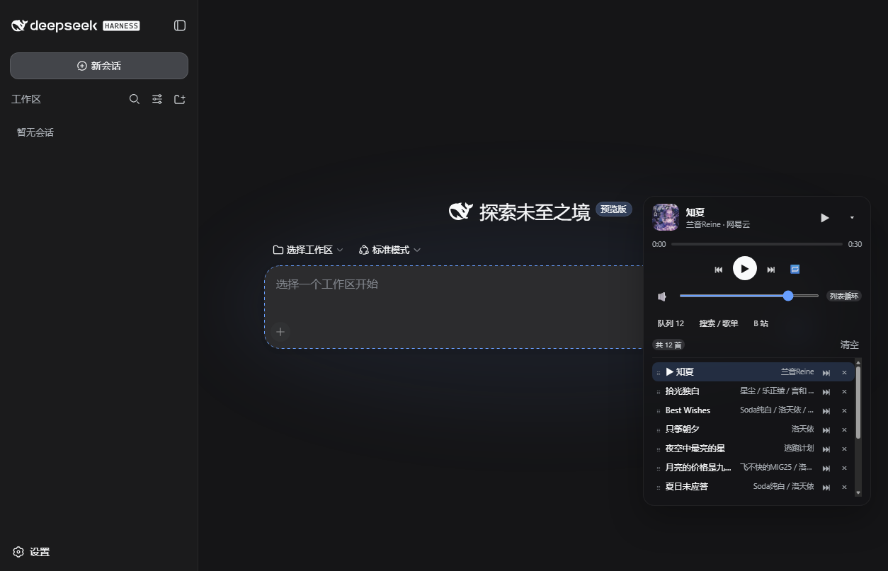
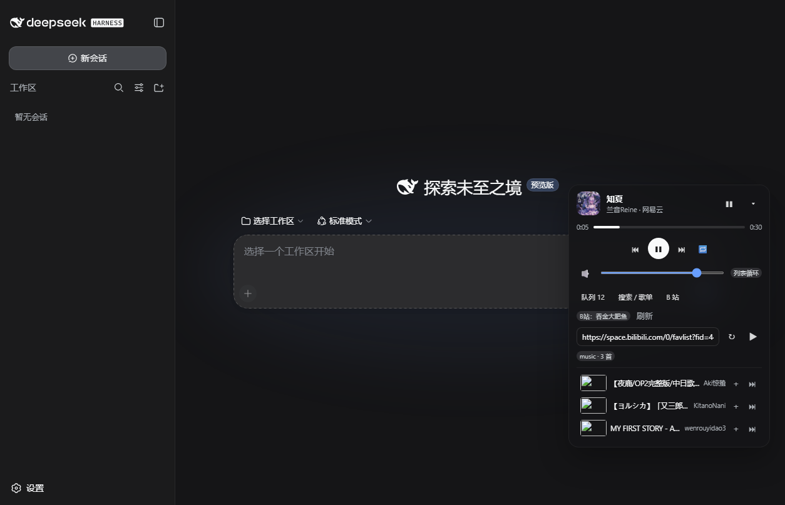

# dsh-music-player

给 [DeepSeek Harness](https://github.com/deepseek-ai/deepseek-harness) 加一个悬浮音乐播放器：在对话界面里直接听歌，主要播放 **B 站收藏夹**里的音乐——只出声、不显示画面。

面向没有网易云 VIP、平时靠 B 站视频听歌的人：把收藏夹变成一个歌单，点开就能听，体验上接近“有自己的 VIP”。



## 功能

- **悬浮播放器**：右下角卡片，可拖动、可折叠，颜色跟随 DSH 主题（亮/暗自动适配），不挡对话
- **B 站收藏夹当歌单**：复用本机已有的 B 站登录态，粘贴收藏夹链接 / id / 名称（比如 `music`）就能载入；只拉音频轨，默认 192k AAC，不请求视频流
- **网易云**：搜索单曲、导入歌单；免费曲匿名可播，配置 Cookie 后可播有权益的 VIP 曲
- **播放器该有的都有**：进度拖动、音量、列表/单曲/随机、队列拖拽排序、“下一首播放”、清空、系统媒体键、本地音频文件
- **边聊边控**：直接说“放我的 B 站收藏夹 / 下一首 / 暂停 / 音量小一点”，agent 会通过 `music` 工具操作
- **状态同步**：SSE 实时推送，多端操作不打架；队列和进度持久化，重启接着听

## 安装

前置：DSH CLI 和 `pnpm`（`dsh plugin` 会调用 pnpm）：

```sh
npm i -g pnpm
```

安装插件（桌面端用 `--profile desktop`，网页端用 `--profile web`）：

```sh
dsh plugin --profile desktop add github:JinXing-01/dsh-music-player
```

装完重启 DSH，页面右下角出现播放器。

卸载：

```sh
dsh plugin --profile desktop remove dsh-music-v2
```

## 使用

### B 站收藏夹（推荐）

1. 播放器 →「B 站」tab，顶部会显示当前复用的 B 站账号；
2. 输入收藏夹链接、id 或名称（例如 `music`），点 ↻；
3. 点单曲播放，或点 ▶ 播放全部（替换当前队列）；
4. 载入过的收藏夹会记住，下次打开自动加载。

登录态复用顺序：插件设置里的 Cookie → bili CLI 的 `credential.json` → bili-whale 的 `credentials.json`。装了这两个工具的人不需要任何操作。

### 登录 B 站（Cookie 方式）

没有装 bili CLI / bili-whale 时，用 Cookie 登录：

1. 浏览器打开并登录 [bilibili.com](https://www.bilibili.com)；
2. 按 `F12` → **Application（应用/存储）** → **Cookies** → `https://www.bilibili.com`；
3. 找到 `SESSDATA`，复制它的**值**（`SESSDATA` 是 HttpOnly，`document.cookie` 取不到）；
4. 回到播放器 →「B 站」tab → 粘贴 → 点「登录」。

保存前会先调一次 B 站接口校验，成功才写入，并显示「B站：昵称」；无效会直接提示。也可以粘贴整段 Cookie（`SESSDATA=...; bili_jct=...`）。

> Cookie 等同于账号登录态，只保存在本机（插件设置 / `~/.dsh/storages/dsh-music-v2/config.json`），不会上传到任何地方；不要把它发给别人。过期后重新复制一次即可。



### 网易云

「搜索 / 歌单」tab：输入歌名/歌手搜索，点结果即加入并播放；粘贴歌单 id 或链接导入；📁 添加本地文件。

### 对话控制

```
放我的 B 站收藏夹
下一首
暂停
音量调到 50%
来点随机
```

## 配置

在 DSH 设置里找到 `dsh-music` 命名空间，或编辑 `~/.dsh/storages/dsh-music-v2/config.json`：

| 字段 | 说明 |
| --- | --- |
| `biliCookie` | 可选。B 站 Cookie（`SESSDATA=…`）；留空自动复用本机登录态 |
| `biliFolder` | 可选。默认收藏夹的链接 / id / 名称（如 `music`） |
| `neteaseCookie` | 可选。网易云 Cookie（含 `MUSIC_U=`），用于有权益的 VIP 曲 |
| `defaultPlaylist` | 可选。启动时自动加载的网易云歌单 |
| `br` | 网易云码率，默认 `320000` |
| `volume` | 初始音量 0-1 |

## 说明与限制

- 只做在线播放：**不下载、不转存、不导出、不传播**音频；请仅用自己有权访问的内容。
- B 站：需要大会员/付费/地区限制的视频会明确提示，不做绕过；多 P 视频目前播放第 1 P；接口和 CDN 策略可能随时调整。
- 网易云：匿名解析对 VIP 曲只给试听，能否播全曲取决于账号权益。
- 本机 CDN 不可达时会自动切备用地址；偶尔需要点一下播放按钮解除浏览器的自动播放限制。

## 参考

本项目参考并重写了 [xiekai886/dsh-MusicPlayer](https://github.com/xiekai886/dsh-MusicPlayer)（MIT）的整体形态与接口思路，音频解析链路重新实现。

## License

[MIT](LICENSE)
